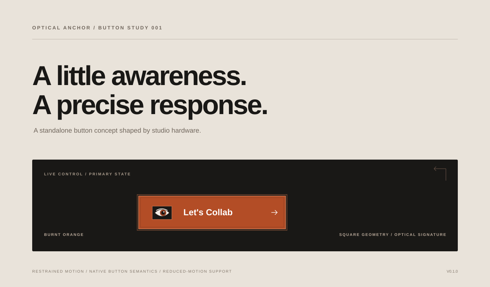

# Optical Anchor Button

A standalone React button concept with a custom optical signature.

Optical Anchor combines a burnt-orange face, a dark precision frame, a hand-drawn eye, page-wide pointer tracking after wake-up, a fatigue-to-sleep cycle, and a short mechanical press response. This is a focused single-component project, not a general UI kit.

[Interactive HTML prototype](Optical-Anchor-Prototype.html) · [Browser validation report](docs/BROWSER-VALIDATION.md)

## Design contract

- Identity: Precision Instrument / Studio Hardware.
- Material: anodized-inspired matte surface with a dark inset frame.
- Geometry: square silhouette, 2 px corner radius, and fine inset edge.
- Signature: one custom-drawn optical eye with restrained brow expression.
- Eye lifecycle: starts asleep, wakes when the button is hovered, tracks pointer direction across the page, grows tired after 2.2 seconds of inactivity, then sleeps 780 ms later.
- Microgravity: the face shifts by at most about 1.15 px horizontally and 0.75 px vertically only while the pointer is over the button. The system cursor is never moved.
- State feedback: default, hover, pressed, focus-visible, disabled, and loading.
- Accessibility: native button semantics, keyboard activation, visible focus, stable label, and reduced-motion support.
- Banlist: no purple/blue gradient, gratuitous glow, glassmorphism, third-party icon packs, emoji, or ambient animation.

See DESIGN-CONTRACT.md for the full specification.

## Run locally

Requires Node.js 20.19+ or 22.12+.

1. Run npm install.
2. Run npm run dev.
3. Open the local URL printed by Vite. Use the state selector to inspect the six states and hover the button to wake the eye, then move the pointer elsewhere in the page. Pause to observe the tired and sleeping states.

## Verify

Run npm run typecheck, npm test, and npm run build.

GitHub Actions runs the same checks on pushes and pull requests. The React build and unit tests still require a successful run in an environment with npm registry access; this execution environment previously failed to resolve registry.npmjs.org (EAI_AGAIN). The last recorded standalone browser report predates the page-wide gaze lifecycle. The updated behavior and React tests have been added, but require a fresh browser/build run before they can be described as verified.

## Component API

OpticalButton extends native React button attributes with loading, size (sm/md/lg), and fullWidth props. The default size is md (44 px); sm is 36 px and lg is 52 px. The default label is Let's Collab, and the default button type is button to avoid accidental form submission.

The eye is decorative and hidden from assistive technology. The visible button label supplies its accessible name.

## Scope excluded from v1

No routing, API calls, built-in tooltips, icon dependencies, cursor manipulation, randomized expressions, sound effects, or generic ripple animation. Showcase state-forcing classes are not part of the public component API.

## License

MIT. See LICENSE.
